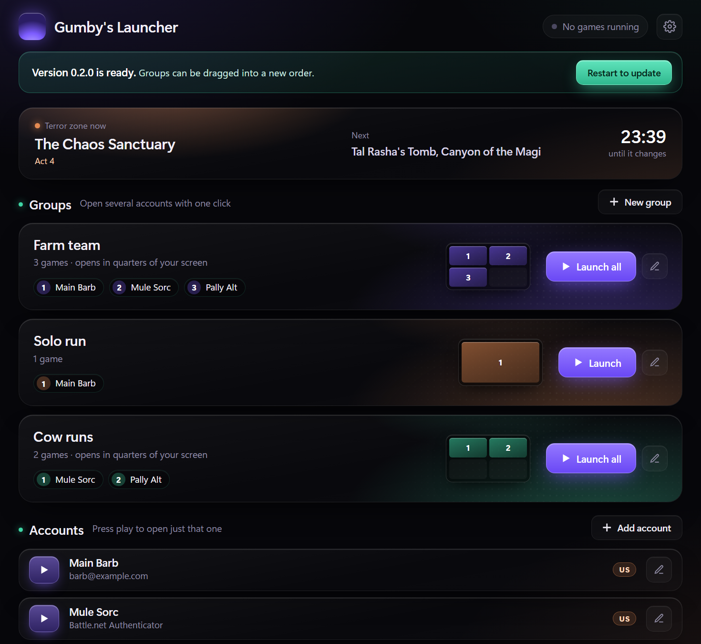
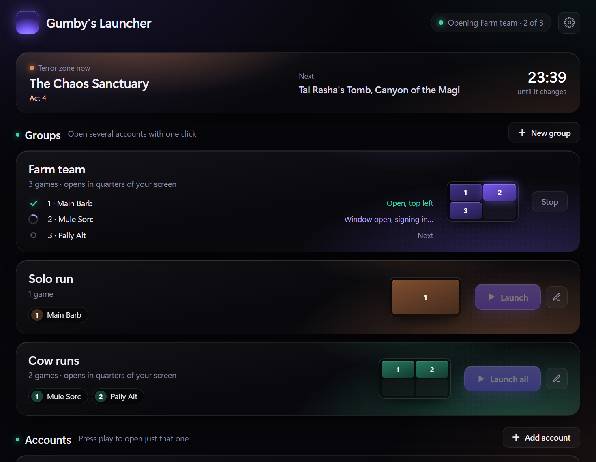
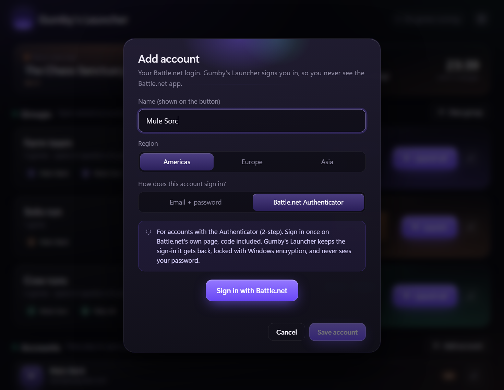

# Gumby's Launcher

A small launcher for Diablo II: Resurrected. Save your Battle.net accounts once, then open them with one click.

- **Play** opens one account, already signed in, intro videos skipped.
- **Launch all** opens a group one after another and puts each game in its own quarter of the screen.
- **Terror zones** now and next, with a countdown.
- **Updates** download by themselves; you choose when to restart.

## Getting started

1. Download **GumbyLauncher.exe** from [Releases](../../releases) and run it. It finds your game by itself.
2. **Add account** with email + password, or **Battle.net Authenticator** if the account uses 2-step.
3. Make a group and press **Launch all**. Set D2R to **Windowed** (Options > Video) so the games fit into quarters.

## Safe by design

- Passwords and sign-ins are locked with Windows encryption for your Windows user and never leave your PC.
- Authenticator accounts sign in on Battle.net's own page; the launcher never sees that password.
- Opening several games closes D2R's "only one copy" lock, nothing else. It's off until you turn it on.
- Problem reports show you exactly what gets sent, without names, emails or passwords, and only on your click.

## Build

Rust + Tauri 2: `tools\build.ps1 -Test` builds `dist\GumbyLauncher.exe`.
